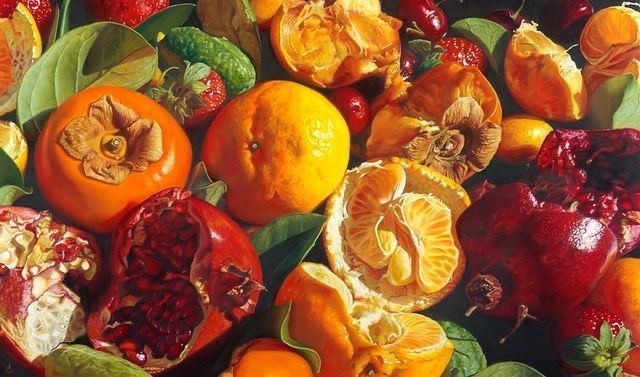

  

<h1 align="center">Daniel Collazo</h1>

  Desarrollador en formación | Software, automatización y herramientas creativas

  <a href="https://github.com/DanielAldana-dca?tab=repositories">Ver mis repositorios</a>
  &nbsp; | &nbsp;
  <a href="https://github.com/DanielAldana-dca?tab=stars">Repositorios destacados</a>

---

## Sobre mí

Soy desarrollador en formación y me interesa construir proyectos prácticos, aprender nuevas tecnologías y mejorar continuamente mis habilidades. Trabajo en proyectos de programación, aplicaciones web, bases de datos y herramientas para Blender.

- Desarrollo proyectos propios para practicar y consolidar conocimientos.
- Me interesa el desarrollo de software, la automatización y la creación de herramientas.
- Mantengo mis avances y proyectos en GitHub.

## Tecnologías y herramientas

  
  
  
  
  
  
  
  
  
  

## Proyectos destacados

### BlenderDev - Plan de estudio de extensiones para Blender
Material organizado por lecciones para aprender a desarrollar extensiones de Blender con Python, con ejemplos, ejercicios y recursos.

[Ver repositorio](https://github.com/DanielAldana-dca/BlenderDev-Addon-Study-Plan)

### Aprendiendo bases de datos
Repositorio de práctica para aprender bases de datos desde los fundamentos, incluyendo SQL y diseño de proyectos.

[Ver repositorio](https://github.com/DanielAldana-dca/aprendiendo-bases-de-datos)

### Web escuela
Proyecto web de práctica con tecnologías del desarrollo frontend.

[Ver repositorio](https://github.com/DanielAldana-dca/web-escuela)

### Más proyectos

Puedes consultar el resto de mis trabajos en la [lista completa de repositorios](https://github.com/DanielAldana-dca?tab=repositories).

## Lenguajes más utilizados

  

---

Aprender · Crear · Mejorar

